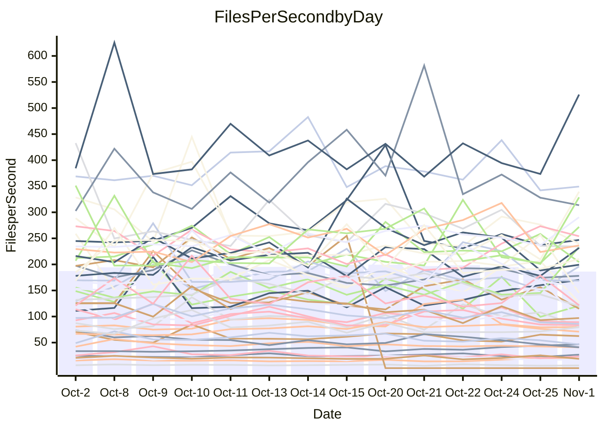

<!---
# This file is auto-generated. Do not edit.
# cspell:disable
--->
# Performance Report

Daily Performance

Time to Process Files

| Repository                                      | Elapsed | Min/Avg/Max          |    SD | SD Graph                |
| ----------------------------------------------- | ------: | :------------------: | ----: | ----------------------- |
| AdaDoom3/AdaDoom3                    |    2.20 | 2.0 /   2.8 /   3.3  |  0.41 | `    ┣━●┻━━╋━━┻━━┫    ` |
| alexiosc/megistos                    |    7.30 | 3.9 /   6.5 /   8.1  |  1.25 | `    ┣━━┻━━╋━●┻━━┫    ` |
| apollographql/apollo-server          |    2.98 | 1.4 /   2.4 /   3.0  |  0.42 | `    ┣━━┻━━╋━━┻●━┫    ` |
| aspnetboilerplate/aspnetboilerplate  |    9.35 | 5.1 /   8.4 /  10.2  |  1.51 | `    ┣━━┻━━╋━●┻━━┫    ` |
| aws-amplify/docs                     |    8.95 | 7.7 /  12.8 /  14.6  |  2.26 | `   ┣●━━┻━━╋━━┻━━━┫   ` |
| Azure/azure-rest-api-specs           |    8.95 | 7.3 /  10.6 /  12.2  |  1.23 | `    ┣━●┻━━╋━━┻━━┫    ` |
| bitjson/typescript-starter           |    1.12 | 0.7 /   1.0 /   1.2  |  0.17 | `     ┣━┻━━╋━●┻━┫     ` |
| caddyserver/caddy                    |    4.48 | 2.3 /   3.8 /   4.6  |  0.67 | `    ┣━━┻━━╋━━●━━┫    ` |
| canada-ca/open-source-logiciel-libre |    1.17 | 0.7 /   1.0 /   1.3  |  0.18 | `     ┣━┻━━╋━●┻━┫     ` |
| chef/chef                            |    0.00 | 0.0 /   3.0 /   5.5  |  2.40 | `    ┣━●┻━━╋━━┻━━┫    ` |
| dart-lang/sdk                        |   56.24 | 38.8 /  56.2 /  76.1 |  8.82 | `  ┣━━━┻━━━●━━━┻━━━┫  ` |
| django/django                        |    8.94 | 8.4 /  13.1 /  15.3  |  2.31 | `   ┣●━━┻━━╋━━┻━━━┫   ` |
| eslint/eslint                        |   10.21 | 5.8 /   9.5 /  11.1  |  1.38 | `    ┣━━┻━━╋━●┻━━┫    ` |
| exonum/exonum                        |    2.47 | 2.0 /   3.2 /   3.8  |  0.54 | `    ┣━●┻━━╋━━┻━━┫    ` |
| flutter/samples                      |   14.17 | 7.2 /  11.1 /  13.0  |  1.69 | `    ┣━━┻━━╋━━┻━━●    ` |
| gitbucket/gitbucket                  |    3.71 | 1.9 /   3.2 /   3.9  |  0.54 | `    ┣━━┻━━╋━━●━━┫    ` |
| googleapis/google-cloud-cpp          |  139.58 | 72.6 / 119.0 / 138.7 | 19.22 | `  ┣━━━┻━━━╋━━━●━━━┫  ` |
| graphql/express-graphql              |    0.97 | 0.7 /   1.1 /   1.3  |  0.17 | `     ┣━┻━●╋━━┻━┫     ` |
| graphql/graphql-js                   |    4.37 | 2.1 /   3.2 /   4.1  |  0.70 | `    ┣━━┻━━╋━━┻━●┫    ` |
| graphql/graphql-relay-js             |    1.20 | 0.7 /   1.1 /   1.4  |  0.20 | `     ┣━┻━━╋━●┻━┫     ` |
| graphql/graphql-spec                 |    1.06 | 0.8 /   1.2 /   1.4  |  0.19 | `     ┣━●━━╋━━┻━┫     ` |
| iluwatar/java-design-patterns        |   13.29 | 7.4 /  12.2 /  14.6  |  2.14 | `    ┣━━┻━━╋━●┻━━┫    ` |
| ktaranov/sqlserver-kit               |    6.06 | 3.4 /   5.3 /   6.8  |  1.08 | `    ┣━━┻━━╋━●┻━━┫    ` |
| liriliri/licia                       |    4.13 | 2.3 /   3.6 /   4.5  |  0.58 | `    ┣━━┻━━╋━●┻━━┫    ` |
| MartinThoma/LaTeX-examples           |    5.20 | 4.1 /   6.4 /   7.5  |  0.86 | `    ┣━●┻━━╋━━┻━━┫    ` |
| mdx-js/mdx                           |    1.75 | 1.2 /   1.8 /   2.1  |  0.27 | `     ┣━┻━━●━━┻━┫     ` |
| microsoft/TypeScript-Website         |    3.28 | 3.1 /   4.9 /   6.3  |  0.77 | `    ●━━┻━━╋━━┻━━┫    ` |
| MicrosoftDocs/PowerShell-Docs        |   25.74 | 14.4 /  22.8 /  27.4 |  3.66 | `   ┣━━━┻━━╋━━●━━━┫   ` |
| neovim/nvim-lspconfig                |    5.95 | 3.2 /   5.3 /   6.6  |  0.90 | `    ┣━━┻━━╋━●┻━━┫    ` |
| pagekit/pagekit                      |    2.92 | 2.1 /   3.4 /   4.1  |  0.57 | `    ┣━━┻●━╋━━┻━━┫    ` |
| php/php-src                          |   25.83 | 13.6 /  22.2 /  26.7 |  4.12 | `   ┣━━━┻━━╋━━●━━━┫   ` |
| plasticrake/tplink-smarthome-api     |    1.51 | 0.8 /   1.2 /   1.5  |  0.21 | `     ┣━┻━━╋━━┻●┫     ` |
| prettier/prettier                    |    8.84 | 4.7 /   7.5 /   9.0  |  1.31 | `    ┣━━┻━━╋━━●━━┫    ` |
| pycontribs/jira                      |    1.28 | 0.9 /   1.4 /   1.7  |  0.22 | `     ┣━┻━●╋━━┻━┫     ` |
| RustPython/RustPython                |   12.73 | 6.5 /  10.4 /  13.2  |  1.82 | `    ┣━━┻━━╋━━┻●━┫    ` |
| shoelace-style/shoelace              |    2.24 | 1.7 /   2.6 /   3.4  |  0.46 | `    ┣━━┻●━╋━━┻━━┫    ` |
| slint-ui/slint                       |   20.82 | 11.7 /  18.4 /  22.5 |  3.35 | `   ┣━━━┻━━╋━●┻━━━┫   ` |
| SoftwareBrothers/admin-bro           |    2.48 | 1.6 /   2.4 /   2.9  |  0.32 | `     ┣━┻━━╋●━┻━┫     ` |
| sveltejs/svelte                      |   17.53 | 13.2 /  22.2 /  26.2 |  3.59 | `   ┣━━●┻━━╋━━┻━━━┫   ` |
| TheAlgorithms/Python                 |    7.00 | 3.8 /   6.1 /   7.3  |  1.06 | `    ┣━━┻━━╋━━●━━┫    ` |
| twbs/bootstrap                       |    2.14 | 1.1 /   1.8 /   2.3  |  0.31 | `     ┣━┻━━╋━━●━┫     ` |
| typescript-cheatsheets/react         |    1.27 | 0.8 /   1.2 /   1.4  |  0.16 | `     ┣━┻━━╋━●┻━┫     ` |
| typescript-eslint/typescript-eslint  |    4.45 | 2.5 /   4.0 /   4.8  |  0.77 | `    ┣━━┻━━╋━●┻━━┫    ` |
| vitest-dev/vitest                    |   12.17 | 6.4 /  10.7 /  13.1  |  1.75 | `    ┣━━┻━━╋━━●━━┫    ` |
| w3c/aria-practices                   |    3.46 | 2.0 /   3.0 /   4.2  |  0.59 | `    ┣━━┻━━╋━●┻━━┫    ` |
| w3c/specberus                        |    1.96 | 1.2 /   1.7 /   2.3  |  0.35 | `     ┣━┻━━╋━●┻━┫     ` |
| webdeveric/webpack-assets-manifest   |    1.34 | 0.9 /   1.2 /   1.4  |  0.11 | `     ┣━┻━━╋━━●━┫     ` |
| webpack/webpack                      |   10.40 | 5.6 /   8.2 /   9.9  |  1.51 | `    ┣━━┻━━╋━━┻━●┫    ` |
| wireapp/wire-desktop                 |    1.79 | 0.9 /   1.4 /   1.7  |  0.24 | `     ┣━┻━━╋━━┻━●     ` |
| wireapp/wire-webapp                  |   11.99 | 9.1 /  13.8 /  16.4  |  2.36 | `   ┣━━━┻●━╋━━┻━━━┫   ` |

Note:
- Elapsed time is in seconds.

Files per Second over Time

| Repository                                      | Files |    Sec |    Fps |     Rel | Trend Fps              |    N |
| ----------------------------------------------- | ----: | -----: | -----: | ------: | ---------------------- | ---: |
| AdaDoom3/AdaDoom3                    |   103 |   2.20 |  46.86 |  26.17% | `▂▆▂█▂▂▄▄▃▂▂▅▁▅▄█▁▅▅▆` |   29 |
| alexiosc/megistos                    |   583 |   7.30 |  79.85 | -14.93% | `▂▁▇▂▂▄▄▂▂▂▇▄█▅▂▄▂▂▂▂` |   29 |
| apollographql/apollo-server          |   256 |   2.98 |  85.95 | -21.50% | `▂▆▄█▁▂▂▂▂▂▂▅▂▂▂▂▁▆▁▁` |   29 |
| aspnetboilerplate/aspnetboilerplate  |  2308 |   9.35 | 246.88 | -13.63% | `▂▂▅▂▄▂▂▄██▂▂▁▂▄▂▂▂▂▂` |   29 |
| aws-amplify/docs                     |  3039 |   8.95 | 339.56 |  36.98% | `▁▂▂▂▂▂▂▂▁▃▂▂▂▂▂▁▁█▁▆` |   29 |
| Azure/azure-rest-api-specs           |  2599 |   8.95 | 290.53 |  16.15% | `▂▂▂▂▃█▂▃▃▅▇▂▅▂▂▃▂▆▃▅` |   29 |
| bitjson/typescript-starter           |    20 |   1.12 |  17.91 | -14.70% | `▅▅▅▂▃█▅▁█▅▂█▂▇▃▄▇▂▂▃` |   29 |
| caddyserver/caddy                    |   400 |   4.48 |  89.19 | -14.27% | `▁▁█▂▅▁▂▂▅▂▁▄▃▂▄▂▇▅▂▂` |   29 |
| canada-ca/open-source-logiciel-libre |     7 |   1.17 |   6.00 | -13.62% | `▃▂▄▂▁▂▇▄▃█▁▂▅▇▄▂▆▂▂▂` |   29 |
| chef/chef                            |     0 |   0.00 |   0.00 | -99.25% | `▇█▇▇▆▆▆█▁▁▁▁▁▁▁▁▁▁▁▁` |   29 |
| dart-lang/sdk                        | 11822 |  56.24 | 210.21 |  -2.33% | `▆▇▃▅▃▃▄█▄▄██▃▃▅▁▄▃▃▄` |   29 |
| django/django                        |  2939 |   8.94 | 328.88 |  41.49% | `▂▁▂▇▇▂▂▄▂█▅█▂▂▅▂▂▂▂█` |   29 |
| eslint/eslint                        |  2087 |  10.21 | 204.34 |  -9.26% | `▂▄▂▁▂▄▂▂█▂▄▁▂▄▂▂▄▄▄▂` |   29 |
| exonum/exonum                        |   421 |   2.47 | 170.15 |  23.47% | `▂▅▅▆▂▂█▂█▂▃▁▄▂▄▅▃▅▅▆` |   29 |
| flutter/samples                      |  1703 |  14.17 | 120.16 | -23.53% | `▂▅▃▂▂▂▃▅▆▂█▂▂▅▁▂▂▂▂▁` |   29 |
| gitbucket/gitbucket                  |   426 |   3.71 | 114.96 | -17.64% | `▃▂▂▄▅▄▂▂▁▂▇▁▂█▄▂▄▁▄▂` |   29 |
| googleapis/google-cloud-cpp          | 22116 | 139.58 | 158.45 | -17.38% | `▁▃▂▂▃▂▄▂▂▄▂▁▂█▂▂▂▇▂▁` |   29 |
| graphql/express-graphql              |    26 |   0.97 |  26.85 |   5.76% | `▇█▂▂▂▆▂▃▂▅▇▁▅▆▃▂▂▆▂▄` |   29 |
| graphql/graphql-js                   |   554 |   4.37 | 126.83 | -31.39% | `█▄▇▁▇▂▂▂▂▇▅▁▂▂▂▇▇▂▅▁` |   29 |
| graphql/graphql-relay-js             |    28 |   1.20 |  23.35 | -13.27% | `█▇▄▂▅▄▂▃▃▂▂▅▂▂▄▃▅▅▁▃` |   29 |
| graphql/graphql-spec                 |    19 |   1.06 |  17.86 |  14.23% | `▂▃▂▂▅▂▂▂▇▂▃▂▂▂▂▂█▇█▅` |   29 |
| iluwatar/java-design-patterns        |  2239 |  13.29 | 168.45 | -12.18% | `▂▂▂▂▄▂▇▃▂▄▁▂▃▇▇▂▂█▂▂` |   29 |
| ktaranov/sqlserver-kit               |   490 |   6.06 |  80.81 | -17.38% | `█▂▂▂▇▄▂▂▇▁▁▁█▄▆▄▄▂▅▂` |   29 |
| liriliri/licia                       |  1442 |   4.13 | 349.36 | -14.32% | `▂▅▄▅▄▄▇▂▄▂▄▁▂▂▃▂▂█▂▂` |   29 |
| MartinThoma/LaTeX-examples           |  1414 |   5.20 | 271.96 |  20.53% | `▇▂▂▂▂▂▁▃▂▂▂▁█▆▃▃▃▂▂▅` |   29 |
| mdx-js/mdx                           |   139 |   1.75 |  79.35 |  -0.20% | `▃▃▆█▆▂▂▂▄▄▂▂▂▂▂▂▂▂▂▃` |   29 |
| microsoft/TypeScript-Website         |   765 |   3.28 | 233.56 |  46.05% | `▂▅▃▅▃▄▅▂▃▅▂▂▅▃▂▃▂▃▃█` |   29 |
| MicrosoftDocs/PowerShell-Docs        |  3127 |  25.74 | 121.49 | -14.15% | `▃▂▂█▄█▂▇▂▂▅▂▂▁▂▂▂▂▇▂` |   29 |
| neovim/nvim-lspconfig                |   884 |   5.95 | 148.62 | -13.49% | `▁▆▂▅▂▅▂▂▅█▃▂▂▂▂▃▂▄▂▂` |   29 |
| pagekit/pagekit                      |   741 |   2.92 | 254.02 |  11.23% | `▂▅▂▂█▁▂▂▂▃▁▂▂▂▅▂▂▆▅▄` |   29 |
| php/php-src                          |  2399 |  25.83 |  92.89 | -17.49% | `▂▆▄█▂▂▄▄▆▂▂▁▁▁▁▂▄▂█▁` |   29 |
| plasticrake/tplink-smarthome-api     |    62 |   1.51 |  41.00 | -25.60% | `▁▂▃▁▅▇▂▂▄▂▆▆█▂▂▅▄▄▂▁` |   29 |
| prettier/prettier                    |  2773 |   8.84 | 313.62 | -17.45% | `▂▂▂▆▂▃▂▅▂▄██▂▂▂▂▄▄▂▁` |   29 |
| pycontribs/jira                      |    80 |   1.28 |  62.58 |   5.85% | `▁▂▆▆▂▂▂▄█▂▅▅▂▄▃▂▂▂▅▄` |   29 |
| RustPython/RustPython                |  1061 |  12.73 |  83.34 | -16.53% | `▂█▅▄▄▄▁▂▂▂▄▄▇▂▁▄▄▂▂▂` |   29 |
| shoelace-style/shoelace              |   440 |   2.24 | 196.10 |  12.28% | `▅▄▄█▂▃▄▇▃▂▅▄▅▂▃▃█▂▂▅` |   29 |
| slint-ui/slint                       |  4922 |  20.82 | 236.45 |  -9.19% | `▂▂█▂▆▂▂▄▂▂▄▃▆▂▆▆█▁▂▂` |   29 |
| SoftwareBrothers/admin-bro           |   441 |   2.48 | 178.15 |  -4.55% | `▅▁▃▃▃▂▆▂▂▂▃▃▃▅▂▃█▃▃▃` |   29 |
| sveltejs/svelte                      |  9221 |  17.53 | 526.01 |  23.41% | `▂▄▂▂█▂▂▂▂▅▂▁▂▅▂▃▂▂▂▅` |   29 |
| TheAlgorithms/Python                 |  1640 |   7.00 | 234.36 | -15.71% | `▅█▂▂▂▁▄▂█▁▄▄▄▂▂▄▄▆▂▂` |   29 |
| twbs/bootstrap                       |   152 |   2.14 |  71.01 |  -9.13% | `▁▃▄▂▂▆▂▃▆▂▂▄▄▂▂▁▂█▃▂` |   29 |
| typescript-cheatsheets/react         |    24 |   1.27 |  18.95 |  -9.71% | `▃▆▂▃▅▃▁▂▃▂█▃▂▂▂▅▃▃▅▂` |   29 |
| typescript-eslint/typescript-eslint  |   887 |   4.45 | 199.31 | -14.69% | `▁█▁▂▂▁▂▇█▂▅▂▂▇▅█▂▁▁▂` |   29 |
| vitest-dev/vitest                    |  2916 |  12.17 | 239.66 | -13.48% | `▂▄▁▄▂▂▂▄▄▅▂▂▂▂█▂▂▂▃▂` |   29 |
| w3c/aria-practices                   |   417 |   3.46 | 120.43 | -17.25% | `▅▆▃▃▄▂▄▃▇▅▅▅▂▂█▂▇█▁▃` |   29 |
| w3c/specberus                        |   190 |   1.96 |  97.12 | -18.01% | `▃█▇▇▅▇▁▅▂▄▅▃▁▂▅▂▂█▂▂` |   29 |
| webdeveric/webpack-assets-manifest   |    55 |   1.34 |  40.96 | -10.77% | `▂█▄▇▃▄█▃▄▄▄▂▃▂▂▃▄▄▃▂` |   29 |
| webpack/webpack                      |  1511 |  10.40 | 145.31 | -23.89% | `▄▂█▂▇▂▁▂▄▂▇▂▂▇▅▂▂██▁` |   29 |
| wireapp/wire-desktop                 |    83 |   1.79 |  46.45 | -22.71% | `█▆▂▂▂█▃▄▆▃▃▂▂▂▂▂▅▄▃▁` |   29 |
| wireapp/wire-webapp                  |  2777 |  11.99 | 231.65 |  12.30% | `▂█▂▂▄█▂▂▇▂▄▅▂▂▂▂▅▃▂▅` |   29 |

Data Throughput

| Repository                                      | Files |    Sec |     Kps |     Rel | Trend Kps              |    N |
| ----------------------------------------------- | ----: | -----: | ------: | ------: | ---------------------- | ---: |
| AdaDoom3/AdaDoom3                    |   103 |   2.20 |  995.79 |  26.17% | `▂▆▂█▂▂▄▄▃▂▂▅▁▅▄█▁▅▅▆` |   29 |
| alexiosc/megistos                    |   583 |   7.30 |  627.42 | -14.93% | `▂▁▇▂▂▄▄▂▂▂▇▄█▅▂▄▂▂▂▂` |   29 |
| apollographql/apollo-server          |   256 |   2.98 |  709.78 | -21.50% | `▂▆▄█▁▂▂▂▂▂▂▅▂▂▂▂▁▆▁▁` |   29 |
| aspnetboilerplate/aspnetboilerplate  |  2308 |   9.35 |  609.07 | -13.33% | `▂▂▅▂▄▂▂▄██▂▂▁▂▄▂▂▂▂▂` |   29 |
| aws-amplify/docs                     |  3039 |   8.95 | 1334.21 |  36.97% | `▁▂▂▂▂▂▂▂▁▃▂▂▂▂▂▁▁█▁▆` |   29 |
| Azure/azure-rest-api-specs           |  2599 |   8.95 |  916.30 |  18.17% | `▂▂▂▂▃█▂▃▃▅▇▂▅▂▂▃▂▆▃▅` |   29 |
| bitjson/typescript-starter           |    20 |   1.12 |   71.65 | -14.70% | `▅▅▅▂▃█▅▁█▅▂█▂▇▃▄▇▂▂▃` |   29 |
| caddyserver/caddy                    |   400 |   4.48 |  858.44 | -12.38% | `▂▁█▂▅▂▂▂▅▂▂▄▃▂▄▂▇▅▂▂` |   29 |
| canada-ca/open-source-logiciel-libre |     7 |   1.17 |   49.70 | -13.62% | `▃▂▄▂▁▂▇▄▃█▁▂▅▇▄▂▆▂▂▂` |   29 |
| chef/chef                            |  1037 |   4.07 | 1253.33 |  20.46% | `▃▄▃█▄▄▃▇▃▄▃█▆▃▃▂▃█`   |   17 |
| dart-lang/sdk                        | 11822 |  56.24 | 1476.81 |  -2.04% | `▆▇▃▅▃▃▄█▄▄██▃▃▅▁▄▃▃▄` |   29 |
| django/django                        |  2939 |   8.94 | 2134.19 |  41.73% | `▂▁▂▇▇▂▂▄▂█▅█▂▂▅▂▂▂▂█` |   29 |
| eslint/eslint                        |  2087 |  10.21 | 1447.87 |  -9.10% | `▂▄▂▁▂▄▂▂█▂▄▁▂▄▂▂▄▄▄▂` |   29 |
| exonum/exonum                        |   421 |   2.47 | 1627.49 |  23.47% | `▂▅▅▆▂▂█▂█▂▃▁▄▂▄▅▃▅▅▆` |   29 |
| flutter/samples                      |  1703 |  14.17 |  716.21 | -23.53% | `▂▅▃▂▂▂▃▅▆▂█▂▂▅▁▂▂▂▂▁` |   29 |
| gitbucket/gitbucket                  |   426 |   3.71 |  565.36 | -17.32% | `▃▂▂▄▅▄▂▂▁▂▇▁▂█▄▂▄▁▄▂` |   29 |
| googleapis/google-cloud-cpp          | 22116 | 139.58 | 1388.65 | -17.11% | `▁▃▂▂▃▂▄▂▂▄▂▁▂█▂▂▂▇▂▁` |   29 |
| graphql/express-graphql              |    26 |   0.97 |  122.89 |   5.76% | `▇█▂▂▂▆▂▃▂▅▇▁▅▆▃▂▂▆▂▄` |   29 |
| graphql/graphql-js                   |   554 |   4.37 |  966.78 | -30.42% | `█▄▇▁▇▂▂▂▂█▅▁▂▂▃▇▇▂▅▁` |   29 |
| graphql/graphql-relay-js             |    28 |   1.20 |   91.72 | -13.27% | `█▇▄▂▅▄▂▃▃▂▂▅▂▂▄▃▅▅▁▃` |   29 |
| graphql/graphql-spec                 |    19 |   1.06 |  600.50 |  14.23% | `▂▃▂▂▅▂▂▂▇▂▃▂▂▂▂▂█▇█▅` |   29 |
| iluwatar/java-design-patterns        |  2239 |  13.29 |  522.66 | -12.18% | `▂▂▂▂▄▂▇▃▂▄▁▂▃▇▇▂▂█▂▂` |   29 |
| ktaranov/sqlserver-kit               |   490 |   6.06 | 1224.39 | -17.38% | `█▂▂▂▇▄▂▂▇▁▁▁█▄▆▄▄▂▅▂` |   29 |
| liriliri/licia                       |  1442 |   4.13 |  418.89 | -14.32% | `▂▅▄▅▄▄▇▂▄▂▄▁▂▂▃▂▂█▂▂` |   29 |
| MartinThoma/LaTeX-examples           |  1414 |   5.20 |  565.08 |  20.53% | `▇▂▂▂▂▂▁▃▂▂▂▁█▆▃▃▃▂▂▅` |   29 |
| mdx-js/mdx                           |   139 |   1.75 |  373.91 |  -0.20% | `▃▃▆█▆▂▂▂▄▄▂▂▂▂▂▂▂▂▂▃` |   29 |
| microsoft/TypeScript-Website         |   765 |   3.28 | 1611.14 |  46.08% | `▂▅▃▅▃▄▅▂▃▅▂▂▅▃▂▃▂▃▃█` |   29 |
| MicrosoftDocs/PowerShell-Docs        |  3127 |  25.74 | 1298.37 | -14.15% | `▃▂▂█▄█▂▇▂▂▅▂▂▁▂▂▂▂▇▂` |   29 |
| neovim/nvim-lspconfig                |   884 |   5.95 |  470.08 | -12.85% | `▁▆▂▅▂▅▂▂▅█▃▂▂▂▂▃▂▄▂▂` |   29 |
| pagekit/pagekit                      |   741 |   2.92 |  529.64 |  11.23% | `▂▅▂▂█▁▂▂▂▃▁▂▂▂▅▂▂▆▅▄` |   29 |
| php/php-src                          |  2399 |  25.83 | 1654.01 | -17.44% | `▂▆▄█▂▂▄▄▆▂▂▁▁▁▁▂▄▂█▁` |   29 |
| plasticrake/tplink-smarthome-api     |    62 |   1.51 |  221.54 | -25.60% | `▁▂▃▁▅▇▂▂▄▂▆▆█▂▂▅▄▄▂▁` |   29 |
| prettier/prettier                    |  2773 |   8.84 |  438.15 | -17.73% | `▂▂▂▆▂▃▂▅▂▄██▂▂▂▂▄▄▂▁` |   29 |
| pycontribs/jira                      |    80 |   1.28 |  441.94 |   5.85% | `▁▂▆▆▂▂▂▄█▂▅▅▂▄▃▂▂▂▅▄` |   29 |
| RustPython/RustPython                |  1061 |  12.73 | 2396.63 | -18.22% | `▂█▅▄▄▄▁▂▂▂▄▄▇▁▁▄▄▁▂▂` |   29 |
| shoelace-style/shoelace              |   440 |   2.24 |  947.08 |  12.28% | `▅▄▄█▂▃▄▇▃▂▅▄▅▂▃▃█▂▂▅` |   29 |
| slint-ui/slint                       |  4922 |  20.82 | 1396.37 |  -8.30% | `▂▂█▂▆▂▂▄▂▂▄▃▇▂▆▆█▂▂▃` |   29 |
| SoftwareBrothers/admin-bro           |   441 |   2.48 |  392.66 |  -4.55% | `▅▁▃▃▃▂▆▂▂▂▃▃▃▅▂▃█▃▃▃` |   29 |
| sveltejs/svelte                      |  9221 |  17.53 |  363.89 |  23.56% | `▂▄▂▂█▂▂▂▂▅▂▁▂▅▂▃▂▂▂▅` |   29 |
| TheAlgorithms/Python                 |  1640 |   7.00 |  672.22 | -15.55% | `▅█▂▂▂▁▄▂█▁▄▄▄▂▂▄▄▆▂▂` |   29 |
| twbs/bootstrap                       |   152 |   2.14 |  598.88 |  -8.28% | `▂▃▄▂▃▆▂▃▆▂▂▄▄▂▂▂▂█▃▂` |   29 |
| typescript-cheatsheets/react         |    24 |   1.27 |  171.30 |  -9.71% | `▃▆▂▃▅▃▁▂▃▂█▃▂▂▂▅▃▃▅▂` |   29 |
| typescript-eslint/typescript-eslint  |   887 |   4.45 |  681.51 | -14.40% | `▁█▁▂▂▁▁▇█▂▅▂▂▇▆█▂▁▁▂` |   29 |
| vitest-dev/vitest                    |  2916 |  12.17 |  722.69 | -12.48% | `▂▄▁▄▂▂▂▄▄▅▂▂▂▂█▂▂▂▃▂` |   29 |
| w3c/aria-practices                   |   417 |   3.46 | 1133.82 | -17.25% | `▅▆▃▃▄▂▄▃▇▅▅▅▂▂█▂▇█▁▃` |   29 |
| w3c/specberus                        |   190 |   1.96 |  317.94 | -18.01% | `▃█▇▇▅▇▁▅▂▄▅▃▁▂▅▂▂█▂▂` |   29 |
| webdeveric/webpack-assets-manifest   |    55 |   1.34 |   94.59 | -10.77% | `▂█▄▇▃▄█▃▄▄▄▂▃▂▂▃▄▄▃▂` |   29 |
| webpack/webpack                      |  1511 |  10.40 | 1392.04 | -16.87% | `▄▂▇▂▇▂▁▂▄▂▇▂▃▇▅▂▂██▂` |   29 |
| wireapp/wire-desktop                 |    83 |   1.79 |  202.01 | -22.11% | `█▆▂▃▃█▃▄▆▄▃▂▂▂▂▂▅▅▃▁` |   29 |
| wireapp/wire-webapp                  |  2777 |  11.99 | 1089.60 |  14.85% | `▂█▂▂▄█▂▂▇▂▄▅▂▂▂▂▅▃▂▅` |   29 |

